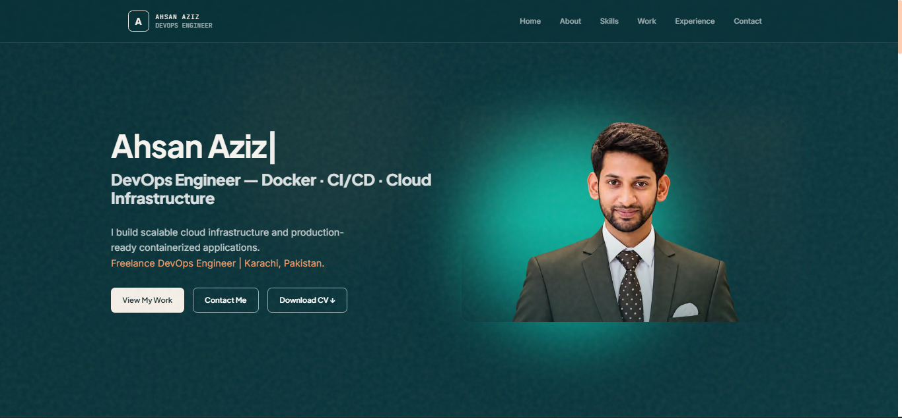
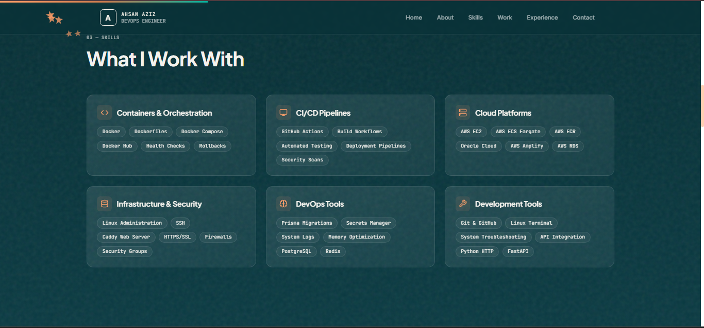
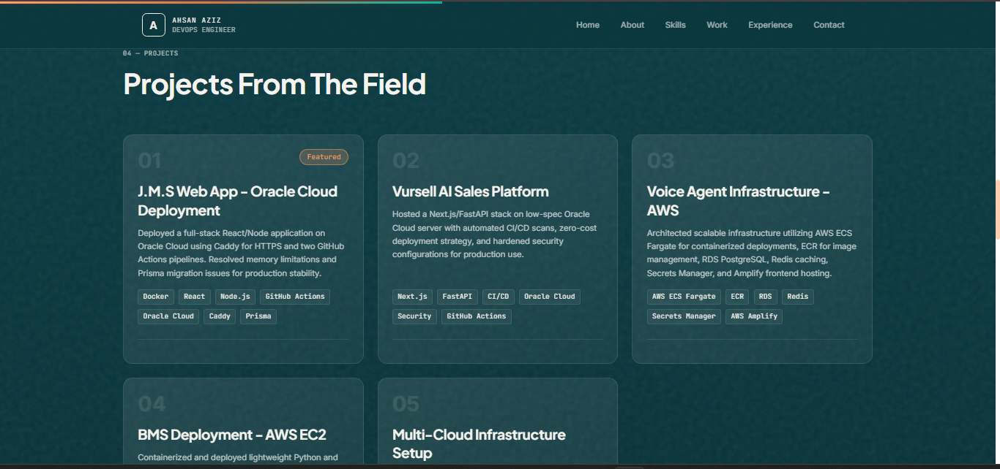
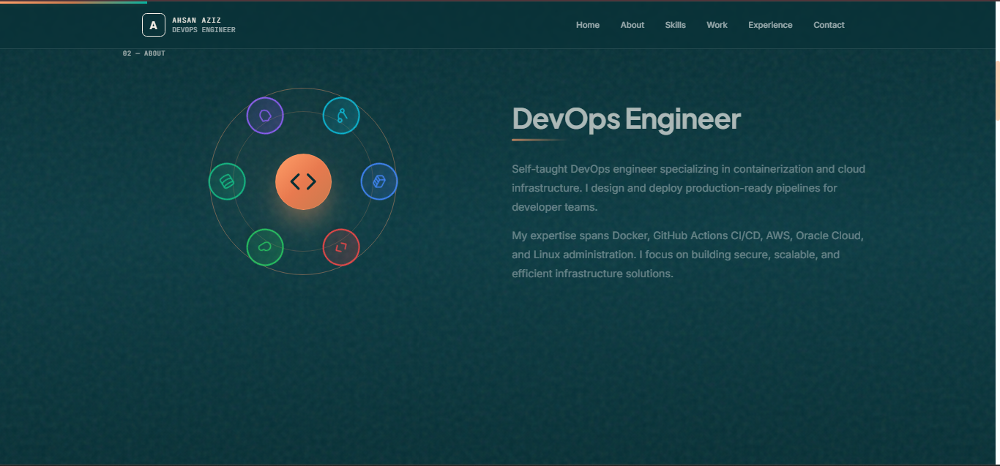

<div align="center">

# Ahsan Aziz — DevOps Portfolio

**A modern, responsive portfolio built with Next.js, React, and Tailwind CSS.**

Fast performance · GSAP animations · TypeScript · Component-based architecture · Fully responsive design


[Report a Bug](https://github.com/Abubakar-webmaker/Portfolio/issues) · [Request a Feature](https://github.com/Abubakar-webmaker/Portfolio/issues)

</div>

---

## Table of Contents

- [Overview](#overview)
- [Screenshots](#screenshots)
- [Features](#features)
- [Tech Stack](#tech-stack)
- [Getting Started](#getting-started)
- [Available Scripts](#available-scripts)
- [Project Structure](#project-structure)
- [Customisation](#customisation)
- [Deployment](#deployment)
- [Troubleshooting](#troubleshooting)
- [Roadmap](#roadmap)
- [Contributing](#contributing)
- [License](#license)
- [Author](#author)

---

## Overview

This is the personal portfolio of **Ahsan Aziz**, a DevOps Engineer based in Karachi, Pakistan. Built with **Next.js and React**, it features a modern, responsive design with smooth animations and a component-based architecture.

The project is fully optimized for performance, with TypeScript for type safety, Tailwind CSS for styling, and GSAP for smooth animations. It can be easily deployed to Vercel or any Node.js-compatible hosting platform.

---

## Screenshots

| Hero | Skills |
|---|---|
|  |  |

| Projects | Journey |
|---|---|
|  |  |

---

## Features

- **Next.js 16** — latest React framework with built-in optimization
- **React 19** — component-based UI architecture
- **TypeScript** — type-safe development experience
- **Tailwind CSS** — utility-first CSS framework
- **GSAP animations** — smooth, performant motion throughout
- **Responsive design** — mobile-first, works on all devices
- **Fast performance** — automatic code splitting and optimization
- **ESLint 9** — code quality and consistency

---

## Tech Stack

| Layer | Technology |
|---|---|
| Framework | [Next.js](https://nextjs.org/) 16 |
| UI Library | [React](https://react.dev/) 19 |
| Language | TypeScript 5 |
| Styling | [Tailwind CSS](https://tailwindcss.com/) 3.4 |
| CSS Processing | PostCSS 8 + Autoprefixer |
| Animations | [GSAP](https://gsap.com/) 3.12 |
| Icons | [Lucide React](https://lucide.dev/) 0.465 |
| Utilities | clsx 2.0 |
| Linter | [ESLint](https://eslint.org/) 9 |

> All dependencies are listed in `package.json`. The project uses Next.js's built-in TypeScript and ESLint configuration.

---

## Getting Started

### Prerequisites

- [Node.js](https://nodejs.org/) **v18+**
- npm or yarn (comes with Node.js)

### Installation

```bash
# 1. Clone the repository
git clone https://github.com/Abubakar-webmaker/Portfolio.git

# 2. Move into the project directory
cd Portfolio

# 3. Install dependencies
npm install

# 4. Start the development server
npm run dev
```

Open **http://localhost:3000** in your browser.

---

## Available Scripts

| Command | Description |
|---|---|
| `npm run dev` | Start the Next.js dev server with hot reload |
| `npm run build` | Create a production build |
| `npm run start` | Start the production server |
| `npm run lint` | Run ESLint to check code quality |

---

## Project Structure

```
Portfolio/
├── app/                     # Next.js app router directory
│   ├── components/          # Reusable React components
│   │   ├── Header.tsx
│   │   ├── Hero.tsx
│   │   ├── About.tsx
│   │   ├── Skills.tsx
│   │   ├── Work.tsx
│   │   ├── Experience.tsx
│   │   ├── Contact.tsx
│   │   ├── MouseCursor.tsx
│   │   └── animations.ts
│   ├── lib/                 # Utility functions
│   ├── layout.tsx           # Root layout
│   ├── page.tsx             # Home page
│   └── globals.css          # Global styles
├── public/                  # Static assets
│   ├── images/              # Portfolio images
│   ├── assets/              # Additional assets
│   └── favicon.svg
├── package.json             # Project dependencies
├── tailwind.config.js       # Tailwind CSS configuration
├── tsconfig.json            # TypeScript configuration
├── next.config.js           # Next.js configuration
├── .eslintrc.json           # ESLint configuration
├── postcss.config.js        # PostCSS configuration
└── README.md
```


## Customisation

| What to change | Where |
|---|---|
| Profile information | `app/components/About.tsx`, `app/components/Hero.tsx` |
| Skills | `app/components/Skills.tsx` |
| Projects/Work | `app/components/Work.tsx` |
| Experience & Certifications | `app/components/Experience.tsx` |
| Contact information | `app/components/Contact.tsx` |
| Colours / design tokens | `app/globals.css` or `tailwind.config.js` |
| Animations | `app/components/animations.ts` |
| Site metadata | `app/layout.tsx` |
| Images | `public/images/` folder |

---

## Deployment

The site is a full Next.js application and requires a Node.js server to run, though it can also be statically exported.

### Vercel (recommended)

1. Push the repository to GitHub.
2. Import the repo at [vercel.com/new](https://vercel.com/new).
3. Vercel automatically detects Next.js and configures it with the correct settings.
4. Deploy in seconds.

### Other platforms

For Node.js hosting (Heroku, Railway, etc.):

```bash
npm run build
npm start
```

For static hosting, you can configure Next.js for static export in `next.config.js`:

```bash
npm run build
# Deploy the `.next/static` folder and `public` folder
```


## Troubleshooting

<details>
<summary><strong>Port 3000 is already in use</strong></summary>

Run `npm run dev -- -p 3001` to use a different port.
</details>

<details>
<summary><strong>TypeScript errors when running</strong></summary>

Run `npm run build` to check for type errors. If there are issues, they'll be reported with file locations and line numbers.
</details>

<details>
<summary><strong>Animations not running smoothly</strong></summary>

Check that hardware acceleration is enabled in your browser. A production build is also smoother than the dev server.
</details>

<details>
<summary><strong>Changes not reflecting in browser</strong></summary>

Next.js has hot reload enabled by default. If changes don't appear, try refreshing the page. If issues persist, restart the dev server with `npm run dev`.
</details>

---

## Roadmap

- [ ] Add a dark/light theme toggle
- [ ] Add a downloadable résumé button
- [ ] Add a Lighthouse performance report badge
- [ ] Add SEO optimization
- [ ] Add analytics integration

---

## Contributing

This is a personal portfolio, but suggestions and bug reports are welcome.

1. Fork the repository
2. Create a feature branch: `git checkout -b feature/your-feature`
3. Commit your changes: `git commit -m "feat: add your feature"`
4. Push to the branch: `git push origin feature/your-feature`
5. Open a Pull Request

Please run `npm run lint` before submitting.

---

## License

This project is licensed under the **MIT License** — see the [LICENSE](LICENSE) file for details.

---

## Portfolio Owner & Credits

**Portfolio For**: Ahsan Aziz — DevOps Engineer  
📍 Karachi, Pakistan

**Designed & Built by**: Abubakar — Web Developer  
[GitHub](https://github.com/Abubakar-webmaker) · [Email](mailto:m.abubakar.codes@gmail.com)

---

⭐ If you like this project, please give it a star!
